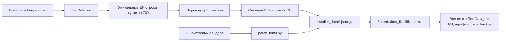

# Техническая инфраструктура v1.0: анализ и карта переиспользования

## Откуда взят код

Исходники v1.0 не сохранились: папок `<папка проекта v1.0>` и `bk_extract` больше нет, а в репозитории [Koshlensky/Baten-Kaitos-HD-Russifier](https://github.com/Koshlensky/Baten-Kaitos-HD-Russifier) лежат только `BatenKaitos_Rusifikator.exe` и `README.md`.

Код восстановлен из транскрипта чата, в котором создавался v1.0: каждый вызов `Write` хранит полный текст файла, а `StrReplace` — точную правку. Скрипт [`tools/recover_v1_code.py`](../tools/recover_v1_code.py) проигрывает их по порядку только для файлов из белого списка. Журнал с хешами — [`legacy_v1/RECOVERY_LOG.md`](../legacy_v1/RECOVERY_LOG.md): 26 операций, все применились однозначно (одна ранняя правка `installer.py` не нашла фрагмент, но её перекрыла полная перезапись файла).

Восстановлены: `installer.py`, `patch_fonts.py`, `pack.py`, `build_data.py`, `validate.py`, `restore.py`. Кириллица в этом коде — только сообщения установщика и отладочный вывод, строк перевода игры нет. Старый словарь, руководство и переводы не извлекались (см. [LEGACY_POLICY.md](../LEGACY_POLICY.md)).

Файл `BatenKaitos_Rusifikator.spec` не восстановлен: его сгенерировал PyInstaller, в транскрипте есть только одна правка и команды сборки (записаны в журнале). На этапе 14 spec создаётся заново.

## Как устроен v1.0



## Компоненты и решения

### `installer.py` — установщик

Что делает:

- `steam_libraries()` и `find_game()` находят игру через реестр (`HKCU\Software\Valve\Steam`), `libraryfolders.vdf` и типовые пути; поддерживают перетаскивание папки на exe.
- `find_bundle()` и `bundle_has_text()` находят текстовый бандл по известному имени или поиском маркера `TextData_en` по всему файлу.
- `ensure_backup()` один раз копирует оригинал в `<игра>\_rus_backup\` (текстовые бандлы в корень, шрифты в подпапки игр).
- `patch_text_bundle()` берёт `TextData_en` из бандла, заменяет строки по словарю «английская строка → русская» и записывает один и тот же документ во все слоты `TextData_*`. Повторный запуск распознаёт уже русский текст по доле совпадений меньше 50%.
- `install_fonts()` копирует 9 пропатченных шрифтовых бандлов в обе игры.
- `install_textures()` перерисовывает меню и «ПАУЗУ» — отключено, потому что игра зависала на загрузке.
- `restore()` возвращает все файлы из `_rus_backup`.
- Интерфейс консоли: Enter — установка, R — откат, `--install`, `--restore`, `--no-pause`.

Решение:

- **Как есть:** поиск игры, `bundle_has_text`, интерфейс, `setup_console`, общая схема бэкапа и отката, запись во все языковые слоты (по просьбе владельца проекта: иначе при выборе другого языка на старте русский не включить).
- **Доработать:**
  - сборка русского документа по ID из `TextIDList`, а не по английскому тексту (подробнее ниже);
  - полное покрытие всех ID с английским текстом как запасным вариантом для непереведённых строк;
  - распознавание повторной установки и обновлений игры по SHA-256 оригиналов, а не по доле совпадений;
  - проверка бэкапов по хешам перед использованием (см. «Найденные ошибки v1.0»);
  - шрифты патчить и проверять отдельно для каждой игры.
- **Не нужен сейчас:** `install_textures()`. Остаётся как материал для отдельного необязательного исследования.

### `patch_fonts.py` — ширина кириллицы

Игра рисует европейские языки японскими шрифтами, где кириллица полноширинная (1000 единиц, как иероглиф). Патч сужает кириллические глифы до ширины по контуру плюс средние боковые отступы латиницы, сдвигает контуры (CFF и glyf) и сохраняет бандл с исходным сжатием (`packer="original"`).

Проверено на копиях (`python -m tools.bkloc.fonts`, отчёт `work/fonts/report.json`): в диалоговом шрифте FOT-NewRodinPro-DB ширина «о» 1000 → 708, латинская «a» не изменилась (680), бандлы перечитываются. Результат совпадает с цифрой из v1.0 (708).

Решение: **функция `patch_font()` как есть.** Замечания на будущее, без изменения кода сейчас:

- Ширина не ограничена сверху: тире «—» стало шире исходного (1000 → 1102 в FOT-NewRodinPro-DB), «Ш» в FOT-ModeMinAStd-B — 1000 → 1020. Возможное улучшение — ограничить новую ширину исходной. Вынесено в [DECISIONS.md](DECISIONS.md).
- MaruBuri-SemiBold не содержит кириллицы (патч меняет 1 глиф), его можно не трогать.
- В TUDShinGoSCGbe-DeB/Med (шрифты китайского слота) нет «ёлочек» `«»`. Если игрок выберет на старте китайский язык, кавычки могут не отобразиться. Учитывается в проверке покрытия символов.
- После первой перепаковки шрифтов игра зависала. В v1.0 это исправили одновременно двумя правками: сохранение с исходным сжатием и пересчёт `hhea.advanceWidthMax`. Какая из них решающая, не установлено, поэтому оставляем обе.

### `pack.py` — ранний упаковщик

Писал только слот `TextData_ru` и пытался обновлять `m_BundleSize` в `catalog.json` поиском открытого текста. На самом деле параметры бандлов лежат в base64-поле `m_ExtraDataString` (разбирается [`tools/bkloc/catalog.py`](../tools/bkloc/catalog.py)), поэтому обновление было пустой операцией. Для текстовых бандлов там `"m_Crc": 0` и `m_BundleSize` = 6 011 447 (BK1) и 4 715 250 (BK2): CRC не проверяется, а размер для локальных бандлов игра не сверяет — подменённые бандлы v1.0 грузились с другим размером. Решение: **не нужен**, его функции покрывает установщик, правка каталога не требуется.

### `build_data.py` — данные установщика

Сжимает словарь «EN → RU» в `installer_data/<игра>.json.gz` и копирует шрифты и оверлеи. Решение: **доработать** — новый формат данных по ID (`text_id → ru` плюс `en_sha1` оригинала), шрифты отдельно для каждой игры, без оверлеев.

### `validate.py` — проверки v1.0

Покрытие, совпадение тегов (`<[^>]*>|%(?:0\d+)?[sdif]`), число переводов строк, наличие имён из словаря. Решение: **идеи переиспользованы** в `tools/qa/` с расширением (порядок тегов, страницы, варианты выбора, род, обращения, ширина). Проверка имён по старому словарю не используется.

### `restore.py`

Откат из папки старого проекта. Решение: **не нужен**, откат делает установщик.

### Нарезка на куски и перевод (в коде не сохранились)

`export_chunks.py` отбирал уникальные английские строки, сортировал по типу и резал на куски по 700 строк без порядка сцен. Решение: **не используется.** Именно этот подход лишал переводчика контекста.

## Главная структурная причина ошибок рода в v1.0

`TextData_en` хранит одинаковые английские строки один раз со списком ID: `{"i":[ID1, ID2, ...], "t":"текст"}`. v1.0 переводил уникальные английские строки и подставлял перевод по совпадению текста:

```python
if source in translations:
    entry["t"] = translations[source]
```

Поэтому реплика вроде «I'm ready.» получала одну форму для всех говорящих, мужчин и женщин. В японском тексте записей больше, чем в английском (13 804 против 13 177 в BK1, 19 378 против 18 757 в BK2): японские строки, различные по смыслу и стилю, в английском схлопнуты в одну.

Группировка ID у каждого языка своя (например, у немецкого `[0, 13871]` там, где у английского `[0]`), а заглушка `TextData_ru` имеет третью группировку. Значит, загрузчик принимает любую группировку, и русский документ можно собирать по ID — с разными переводами одной английской фразы. Это будет проверено в игре на пилоте (этап 9).

## Найденные ошибки v1.0

1. **Неточный бэкап MaruBuri для BK2.** Сверка `_rus_backup` с чистыми файлами Steam: 50 из 51 совпадают. Файл `_rus_backup\Batenkaitos2\a47c4183f78d7352fe1602e63a7987a1.bundle.original` весит 1 254 858 байт, а файл Steam в BK2 — 1 310 720 байт. Разбор показал, что файл BK2 — это тот же бандл, что в BK1, дополненный 55 862 нулевыми байтами (каталог BK2 сам ожидает 1 254 858). v1.0 считал шрифты двух игр одинаковыми и копировал версию BK1 в обе игры, а бэкапы заменил файлами из своей общей папки. Для игры это безвредно, но откат v1.0 не возвращал этот файл байт-в-байт, и проверка файлов Steam сочла бы его изменённым. Остальные 8 шрифтов в двух играх побайтово одинаковы. Вывод для v2.0: бэкапы проверяются по SHA-256 эталонов, шрифты обрабатываются для каждой игры отдельно.
2. **Текстовые бандлы без сжатия.** `patch_text_bundle()` сохранял их через `env.file.save()` без параметров, то есть без сжатия (флаги 64/64), а оригинал сжат LZ4HC (`dataflags=579`). В игре это работало, но бандл рос в несколько раз. Для v2.0 на пилоте проверим `packer="original"`; запасной вариант — поведение v1.0.
3. **Распознавание повторной установки по доле совпадений** зависит от словаря «EN → RU» и ломается при новом формате данных.

## Что меняется в v2.0

- Данные перевода: `text_id → ru` с `en_sha1` оригинала. Сборка документа: для каждого ID из `TextIDList` берётся русская строка, если `en_sha1` совпадает с текущим английским текстом; иначе английская и предупреждение (игра обновилась).
- Источник для сборки — проверенный оригинал: текущий бандл, если его SHA-256 совпадает с эталоном из `source/<игра>/manifest.json`, или бэкап с таким же хешем. Бэкап с чужим хешем не используется.
- Шрифты патчатся для каждой игры отдельно; бандлы без кириллицы не трогаются.
- Существующий `_rus_backup` в папке игры остаётся на месте. Установщик v2.0 должен проверить его по эталонным хешам; для MaruBuri в BK2 эталоном служит файл Steam (1 310 720 байт), а не бэкап v1.0.

## Что не трогаем на подготовительном этапе

Файлы игры, существующий `_rus_backup`, сборку exe и публикацию.
