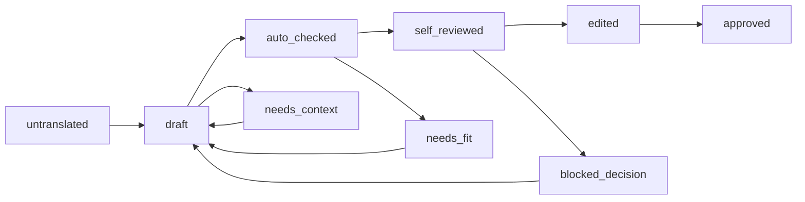

# Переводческая база: структура и правила

## Состав

```
source/<игра>/            оригинал: сырые ассеты, lines.jsonl (все языки по ID), manifest.json, inventory.json
base/scenes/              <игра>_scenes.json (сцены), <игра>_order.json (порядок, prev/next), <игра>_batches.json (рабочие пакеты)
base/evidence/            <игра>.jsonl — улики о говорящем/роде/адресате; pilot_expected.json — ручная оценка пилота
base/matrix/<игра>/       матрица переводов JSONL по шардам + _index.json; схема — base/matrix/schema.json
base/characters/          карточки персонажей (shared/, bk1/, bk2/), шаблон _template.yaml, кандидаты
base/glossary/            glossary.yaml (утверждённые термины), candidates_*.csv (кандидаты), disputes.md (спорные)
base/memory/              краткое содержание предыдущих событий по каждой игре
base/progress/state.json  статус каждого пакета для продолжения работы
runs/                     журнал запусков модели (вход, хеш промпта, модель, ответ)
reports/qa/               отчёты проверок
exports/                  XLSX только для просмотра (пересоздаётся)
```

Две игры разделены (`bk1`, `bk2`), глоссарий и общие персонажи — общие (`base/glossary`, `base/characters/shared`).

## Матрица переводов

Одна запись на ID (BK1 — 14 716, BK2 — 20 316). Шарды: семейство скриптов (`SCR_KOM.jsonl`) или группа ID (`MGN.jsonl`, `SYS.jsonl`); сюжет BK2 — по 10 блоков (`EV_block000-009.jsonl`). Внутри шарда записи идут в порядке игры.

Поля (полная схема — `base/matrix/schema.json`):

| Поле | Что хранит |
|---|---|
| `key` | Стабильный ключ `игра:ID`, например `bk1:SCR_EVE08_2_2936` |
| `game`, `source_file`, `text_id`, `id_index` | Игра, бандл/ассет оригинала, ID и его индекс (справочно) |
| `category`, `form`, `flags` | Категория, подтип строки, флаги (`voiced`, `mentions_spirit`, `internal_suspect`) |
| `scene_id`, `batch_id`, `order`, `global_order` | Сцена, рабочий пакет, порядок в сцене и в игре |
| `prev_key`, `next_key` | Предыдущая и следующая реплики сцены |
| `en`, `en_sha1` | Английский оригинал и его хеш |
| `dedup_group`, `dedup_size` | Общая запись `TextData_en` и число ID, которые её делят |
| `tags` | Теги и подстановки оригинала по порядку |
| `variant` | Вариант реплики духа-хранителя BK1 (`spirit_gender`, `m`/`f`, ID пары) |
| `speaker` | `id`, `status`, `candidates`, `gender_evidence`, `style`, `basis` |
| `speaker_gender` | `m`, `f`, `n` (без рода), `mixed` (хор), `unknown` |
| `addressee`, `addressee_gender` | Адресат и его род (`group` — несколько человек) |
| `register` | `ty`, `vy`, `mixed`, `na`, `unknown` |
| `context` | Контекст для переводчика (автоматические пометки + разметка) |
| `ru` | Новый русский перевод |
| `status` | Статус перевода (ниже) |
| `qa_flags` | Флаги проверок (например, `source_changed`) |
| `translator_note`, `editor_note` | Комментарии переводчика и редактора |
| `history` | Журнал изменений: время, исполнитель, действие, ссылка на запуск, прежний текст |

Старого перевода v1.0 в матрице нет и быть не должно: лишние поля отклоняет валидатор, источники v1.0 ловит `legacy_guard`.

### Статусы перевода



- `untranslated` — перевода нет.
- `draft` — перевод модели принят в матрицу.
- `auto_checked` — автоматические проверки пройдены.
- `self_reviewed` — самопроверка рода, обращений и терминов пройдена.
- `edited` — редактор (отдельная сессия) сверил с английским.
- `approved` — принято владельцем проекта или выборочной проверкой.
- `needs_context` — не хватает данных (говорящий, адресат, смысл); перевод может быть нейтральным черновиком.
- `blocked_decision` — ждёт решения из [DECISIONS.md](DECISIONS.md) (например, термин или стратегия рода).
- `needs_fit` — не помещается в окно или поле интерфейса.

### Статусы говорящего и адресата

`confirmed_data` (из кода игры), `confirmed_text` (однозначно из текста: самоназвание, обращение), `inferred` (по уликам и сцене, с указанием основания), `unknown`, `needs_context`.

## Правила работы с базой

1. Матрица пересобирается командой `python -m tools.bkloc.matrix`; уже заполненные поля перевода и разметки сохраняются. Если английский текст изменился (обновление игры), запись получает `needs_context` и флаг `source_changed`.
2. Перевод попадает в матрицу только через инструменты пайплайна (см. [07_translation_process.md](07_translation_process.md)), чтобы сработали проверки и записался `history`.
3. XLSX в `exports/` — только для чтения.
4. После любого изменения: `python -m tools.qa.validate_matrix` и git-коммит.
5. Японский и европейские тексты лежат в `source/`, а не в матрице. Это справка для разметки и неоднозначных мест, а не источник перевода.
