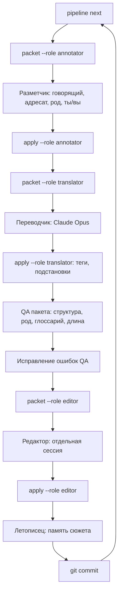

# Процесс перевода

Как идёт перевод на этапах 8–12: от пакета строк до утверждённого текста в матрице. Инструмент — `python -m tools.bkloc.pipeline`, шаблоны ролей — `prompts/`.

## Предпосылки

Массовый перевод начинается только после того, как пилот (этапы 8–9) завершён и владелец утвердил его качество. До этого должны быть готовы: глоссарий имён и ключевых терминов (этап 6), карточки говорящих персонажей (этап 5), руководство по стилю и правила рода (этап 7; решения D-001…D-020 приняты 18.10.2026).

## Единица работы

- **Сцена** — единица контекста: событие скрипта BK1 (`SCR_{скрипт}_{событие}`), блок сюжета BK2 (~60 строк `EV_…`), блок полевых реплик локации, набор строк интерфейса или магнусов.
- **Пакет** — единица работы: 40–150 строк. В BK1 короткие события одной локации объединяются в пакет (медиана 36 строк, 388 пакетов); в BK2 пакет = сцена (медиана 60 строк, 367 пакетов). Файлы: `base/scenes/<игра>_batches.json`.
- Порядок — глобальный порядок сцен (`global_order`): сюжет идёт последовательно, чтобы память сюжета копилась в правильной последовательности.

## Границы работ и допуск

- Что разрешено переводить, записано в `base/progress/approvals.json`: границы с решением владельца (сейчас — пилот, D-027), разрешёнными ролями и единицами работы. Единица — набор сцен или ID (`bk1:P1_intro`, `bk2:P8_lolo`); заблокированные ID перечислены отдельно (например, служебные строки по D-011).
- `pipeline packet` и `pipeline apply` для ролей `translator` и `editor` работают только со строками в этих границах. Пакет, где есть строки вне границ, отклоняется целиком: массовый перевод без решения владельца не начинается. Разметка (`annotator`) разрешена для любых пакетов — это подготовка, а не перевод.
- `pipeline scope` показывает границы, единицы, число строк и их статус. Самотест QA (`run_qa --selftest`) проверяет, что допуск не ослаблен.
- Расширить границы (например, на главу BK1 после пилота) можно только записью нового решения в `DECISIONS.md` и новой областью в `approvals.json`.

Почему это появилось (18.10.2026). Внешняя автоматическая проверка остановила команду, которая собирала пакет переводчика для дымового теста, пока пилот ещё не был разрешён. Сборка пакета — первый шаг перевода, поэтому остановка была верной. Причина — не в проверке, а в процессе: решение владельца нигде не фиксировалось в виде, понятном инструменту, и единственной защитой была внешняя проверка. Теперь разрешение записано в данных проекта и проверяется самим `pipeline`; для дымовых тестов не используются шаги перевода. Если внешняя проверка всё же остановит разрешённую команду, используется штатное подтверждение владельца, а не обходной путь.

## Цикл одного пакета

1. `pipeline next --game bk1` — следующий неутверждённый пакет.
2. `pipeline packet <пакет> --role annotator` — вход для разметчика: строки по порядку, японская и европейская справка, автоматические улики, карточки, память сюжета, хвост предыдущего пакета. Файл: `runs/<дата>/<пакет>_annotator_input.md`.
3. Разметчик возвращает JSON по `prompts/annotator.md`. `pipeline apply … --role annotator --file <ответ>` записывает говорящего, адресата, род, «ты/вы», контекст и флаг `needs_reference`.
4. `pipeline packet … --role translator` — вход для переводчика: строки с замаскированными тегами (`⟦w⟧`, `⟦v3⟧`, `⟦n0⟧`, `⟦%s⟧`), разметка, карточки участников, термины глоссария из этих строк, память, официальная сводка-ориентир, хвост прошлого пакета; японская справка — только для строк с `needs_reference`.
5. Переводчик (Claude Opus) возвращает JSON по `prompts/translator.md`. `apply --role translator` восстанавливает теги, проверяет количество и порядок структурных тегов, подстановки и парные теги; строки с ошибками не принимаются. Принятые получают статус `draft` (или `needs_context`/`blocked_decision`) и запись в `history`.
6. QA пакета (`tools/qa`) — структурные и лингвистические проверки. Ошибки исправляются повторным запуском переводчика только по проблемным строкам; статус `auto_checked`, после самопроверки рода и терминов — `self_reviewed`.
7. `pipeline packet … --role editor` — редактор видит английский оригинал, перевод, разметку и вопросы переводчика, но не ход рассуждений переводчика и никаких других переводов. `apply --role editor` записывает итог (`edited`) и комментарий с категорией правки.
8. Летописец (`prompts/summarizer.md`) сохраняет память по каждой сюжетной сцене в `base/memory/scenes/<scene_id>.md` (события, отношения, обращения, факты отдельно от предположений, решения перевода, вопросы) и короткий блок в `base/memory/story_so_far_<игра>.md` — только для пакетов, переведённых в порядке сюжета (пилотные сцены туда не записаны). Новые факты о персонажах переносятся в карточки с уровнем достоверности.
9. `python -m tools.qa.validate_matrix` и git-коммит с номером пакета.

## Литературная проверка главы

После каждой главы (BK1 — участок между соседними официальными сводками `SaveStoryLine`, BK2 — глава `STORYOUTLINENAME`) отдельный рецензент читает русский текст главы подряд, как читатель, а не построчно:

- связность и ритм сцен, единство голосов персонажей, повторы и канцелярит;
- согласованность имён, терминов, обращений «ты/вы» и рода на протяжении главы;
- соответствие тону английского оригинала в ключевых сценах (выборочная сверка).

Итог — отчёт `reports/chapters/<игра>_<глава>.md` с найденными проблемами и правками, которые вносятся через `apply --role editor`. Владелец проекта выборочно читает главу и утверждает её; после этого пакеты главы получают статус `approved`.

## Роли и модели

- **Разметчик**, **переводчик**, **редактор**, **летописец** — Claude Opus. В Cursor каждую роль выполняет отдельный субагент (Task) с моделью по умолчанию; вход — файл пакета, выход — JSON-файл в той же папке `runs/<дата>/`.
- Редактор — всегда отдельная сессия. Вариант с перекрёстной проверкой другой моделью — решение D-018.
- Человек (владелец проекта) — утверждение решений, выборочная проверка, ответы на `needs_context` и `blocked_decision`.

## Параллельность

- Сюжетные пакеты одной игры идут последовательно: память сюжета и отношения персонажей должны копиться по порядку.
- Параллельно допустимо: пакеты интерфейса, магнусов, справки; полевые реплики разных локаций после того, как сюжет этой части переведён; две игры — независимо, при общем утверждённом глоссарии.
- Один пакет — один субагент. В пакет не подмешиваются несвязанные тексты.

## Продолжение после перерыва или потери контекста

Всё состояние хранится в файлах, а не в памяти модели:

- `base/progress/state.json` — статус каждого пакета (`pending → annotated → translated → edited → approved`) и ссылки на запуски;
- `base/matrix/` — статус и история каждой строки;
- `base/memory/story_so_far_<игра>.md` — что произошло в сюжете; `official_outline_<игра>.md` — официальная канва;
- `runs/<дата>/` — входы и ответы каждого запуска (воспроизводимость, хеш шаблона промпта);
- git-история — коммит после каждого пакета.

Чтобы продолжить: `pipeline status`, затем `pipeline next --game …` и цикл с шага 2. Новая сессия агента начинает с чтения `README.md`, `docs/07_translation_process.md` и вывода `pipeline status`.

## Очереди на решение

- `needs_context` — строки, где не хватает данных о говорящем или смысле. Разбираются пачкой после каждой главы: разметчик с расширенным контекстом, затем человек.
- `blocked_decision` — строки, ждущие решения из `DECISIONS.md`. После решения переводятся заново.
- `needs_fit` — не помещается в окно или поле интерфейса; правится после калибровки ширины.

## Объём и ориентиры

- Английский текст: BK1 ~213 тыс. слов, BK2 ~270 тыс. слов (уникальные строки; диалоги — ~175 и ~213 тыс.).
- Пакетов: 755. На пакет — 4 запуска модели (разметка, перевод, редактура, память) плюс исправления после QA.
- Пилот (этап 8) покажет реальную скорость и долю `needs_context`; по нему уточняется план этапов 10–12.
