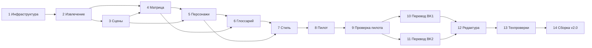

# План работ: 14 этапов

Для каждого этапа — результат, критерии готовности, зависимости и состояние после подготовительного этапа (18.10.2026). «Исполнитель» — агент; «владелец» — владелец проекта (решения, утверждение, тесты в игре).

## 1. Анализ старой технической инфраструктуры — выполнено

- **Результат:** `legacy_v1/` (6 файлов, восстановлены из транскрипта, журнал с хешами), [01_infrastructure_v1.md](01_infrastructure_v1.md) с решением по каждому компоненту, проверка патча шрифтов на копиях (`tools/bkloc/fonts.py`), разбор каталога Addressables (`tools/bkloc/catalog.py`), аудит `_rus_backup`.
- **Критерии:** у каждого компонента решение «как есть / доработать / не нужен»; патч шрифтов на копиях даёт ширину «о» 1000 → 708, как в v1.0. Выполнено.
- **Зависимости:** нет.

## 2. Извлечение оригинальных английских текстов — выполнено

- **Результат:** `source/bk1|bk2/` — сырые ассеты всех 16 слотов, `lines.jsonl` (EN + справочные языки по ID), `manifest.json` (хеши бандлов, ассетов, шрифтов, параметры каталога), инвентарь и каталог тегов ([02_text_inventory.md](02_text_inventory.md)).
- **Критерии:** 14 716 и 20 316 ID с английским текстом; повторная сериализация байт-в-байт для всех 32 ассетов; маскировка тегов обратима для всех строк. Выполнено.
- **Зависимости:** 1.

## 3. Восстановление последовательности сцен — выполнено (этап A)

- **Результат:** скелет сцен и пакетов (`base/scenes/`), отчёт RE-пробы ([03b](03b_re_spike_report.md)), прототип улик ([03c](03c_evidence_prototype.md)), сводка ответов на вопросы исследования ([03](03_context_recovery.md)), этап A реверс-инжиниринга ([03d](03d_re_stage_a_report.md)): говорящие по табличкам имени (BK1 — 5 806, BK2 — 8 901 диалоговая строка), порядок реплик внутри файлов скриптов, карта «строка → файл скрипта» для обеих игр.
- **Критерии:** каждый ID в сцене с порядком и соседями — выполнено; межсобытийный порядок помечен как точный или приблизительный — выполнено; вердикт по RE получен — выполнено; этап A (D-016) — выполнено, дальнейший RE — только по согласованию.
- **Известное ограничение:** порядок NPC-сцен между собой в скелете BK1 приблизителен (например, `SCR_GEM03` стоит раньше `SCR_GEM02`, `SCR_KOM13` — слишком рано).
- **Зависимости:** 2.

## 4. Создание матрицы переводов — выполнено

- **Результат:** `base/matrix/` (35 032 записи, 232 файла), схема `schema.json`, валидатор, выгрузка XLSX, описание ([04_translation_base_schema.md](04_translation_base_schema.md)).
- **Критерии:** валидатор без ошибок, одна запись на ID, `legacy_guard` без нарушений, сборка документа по ID в копию бандла проходит. Выполнено.
- **Зависимости:** 2, 3.

## 5. Подготовка справочника персонажей — персонажи пилота готовы

- **Результат:** карточки всех говорящих персонажей обеих игр по шаблону (`base/characters/`): пол с источником, манера речи (EN и JP), формальность, отношения и «ты/вы» по парам, особенности перевода, спойлеры.
- **Сделано:** шаблон с уровнями достоверности фактов (`confirmed` / `inferred` / `unknown`) и табличками имени; 14 карточек (Kalas, Xelha, Gibari, Lyude, Savyna, Mizuti, Georg, Larikush, Giacomo, Sagi, Milly, Guillo, Lolo, дух-хранитель); улики по собственным репликам персонажей (`tools/bkloc/char_evidence.py`); проверка употребления Guillo (D-004); точка раскрытия Mizuti (D-005); отношения и «ты/вы» по парам пилота; списки кандидатов.
- **Дальше:** карточки остальных говорящих — по мере перевода глав (таблички имени дают список говорящих и число реплик).
- **Критерии:** у всех персонажей основного сюжета пол указан с источником или `unknown`; таблица «ты/вы» для ключевых пар заполнена; спорное вынесено в D-002…D-006.
- **Исполнитель/владелец:** агент собирает (сцены, японская речь, улики, внешние источники с цитированием), владелец утверждает спорное.
- **Зависимости:** 3, 4.

## 6. Подготовка глоссария — термины пилота приняты предварительно

- **Результат:** `base/glossary/glossary.yaml` — имена, локации, организации, магнусы, предметы, экипировка, способности, враги, механики, сюжетные понятия, интерфейс; общие и по играм; склонение; `disputes.md` с вариантами.
- **Сделано:** 70 записей: 52 утверждены (большинство предварительно, D-021, D-025), 15 предложены (в том числе Xelha, Lyude и 6 терминов, появившихся в пилоте), 3 спорных (титул Mizuti, End Magnus, Wings of the Heart); правила D-011…D-013; автоматические списки кандидатов.
- **Критерии:** решения D-001 и D-009 приняты; все имена, локации, организации и механики — `approved` или явно отложены; магнусы — по правилу перевода названий, утверждённому на образце.
- **Зависимости:** 4, 5.

## 7. Разработка руководства по стилю — решения приняты, примеры готовы

- **Результат:** утверждённые [05_style_guide.md](05_style_guide.md) и [06_gender_rules.md](06_gender_rules.md), примеры «плохо / хорошо» на реальных строках игры, решения D-002…D-008, D-010, D-011, D-020.
- **Сделано:** решения D-001…D-020 приняты (18.10.2026); 18 примеров «плохо / хорошо» на строках пилотных сцен — [10_pilot_review.md](10_pilot_review.md).
- **Критерии:** владелец подтвердил список решений — выполнено; примеры на реальных строках — ждут оценки владельца.
- **Зависимости:** 5, 6.

## 8. Пробный перевод нескольких сюжетных сцен — выполнено

- **Результат:** 6–8 сцен разных типов (список — D-019): вступление BK1, `SCR_EVE15_1`, `SCR_EVE08_2`, лавка и NPC локации, пачка магнусов с описаниями, экран интерфейса, вступление BK2, `EV_0596–0624` — полным циклом `pipeline`: разметка → перевод → QA → редактура → память.
- **Сделано:** 201 строка 8 единиц (D-027) переведена по сценам и отредактирована тремя независимыми редакторами; все строки в статусе `edited`; память 11 сцен дополнена решениями перевода — [11_pilot_results.md](11_pilot_results.md).
- **Критерии:** все автоматические проверки без ошибок — выполнено; каждая строка прошла редактора — выполнено; журнал запусков в `runs/20261018/` — выполнено.
- **Зависимости:** 4–7.

## 9. Проверка качества пробного перевода — отчёт готов, игровой тест ждёт подтверждения

- **Результат:** отчёт QA, разбор владельцем, тест в игре на резервной копии (сборка по ID, перенос строк, вместимость окон, шрифты, вариант реплик духа в русском слоте — D-003), калибровка порогов ширины, уточнённые руководство, промпты и `gender_lint`.
- **Сделано:** отчёт QA и литературной проверки, разбор ширины и шрифтов, сборка в копии бандлов, исправлены ложные срабатывания `gender_lint` и построчных проверок — [11_pilot_results.md](11_pilot_results.md). Пилот установлен в обе игры для теста (D-028) с резервными копиями и откатом — чек-лист [12_pilot_ingame_checklist.md](12_pilot_ingame_checklist.md). Ждут: проверка владельцем в игре и разбор результатов.
- **Критерии:** качество принято владельцем; переполнений нет; пороги откалиброваны; известна доля `needs_context` и скорость на пакет.
- **Зависимости:** 8.

## 10. Полный перевод первой игры — идёт (D-029)

- **Ход:** 18.10.2026 — 12 из 388 пакетов (343 новые строки), контрольная точка 1 — [13_checkpoint_1.md](13_checkpoint_1.md); продолжение — после подтверждения владельца.

- **Результат:** все 388 пакетов BK1 прошли разметку, перевод и QA; очереди `needs_context` и `blocked_decision` разобраны по главам.
- **Критерии:** 100% строк с переводом (кроме решённых по D-011/D-012/D-013); 0 блокирующих ошибок; память сюжета и карточки обновлены.
- **Зависимости:** 9.

## 11. Полный перевод второй игры

- **Результат и критерии:** то же для 367 пакетов BK2.
- **Зависимости:** 9; общие термины и персонажи — из глоссария и карточек, уточнённых на этапе 10 (BK2 — приквел, многие названия общие).

## 12. Независимая редактура всех переведённых строк

- **Результат:** каждая строка прошла редактора в отдельной сессии со сверкой с английским; журнал правок по категориям; выборочная проверка владельцем.
- **Критерии:** 100% строк в статусе `edited`, выборка владельца принята, все снятые предупреждения QA обоснованы в `editor_note`.
- **Зависимости:** 10, 11.

## 13. Автоматические технические проверки

- **Результат:** `run_qa --build` по обеим играм: структура, теги, подстановки, род, глоссарий, имена, ширина, глифы, сборка в копию бандла и перечитывание.
- **Критерии:** 0 ошибок; предупреждения `gender_*`, `tags_*`, `placeholders`, `glossary_*` сняты или исправлены.
- **Зависимости:** 12.

## 14. Сборка и тестирование русификатора v2.0

- **Результат:** установщик v2.0 на основе v1.0 с доработками из [01_infrastructure_v1.md](01_infrastructure_v1.md): данные по ID с `en_sha1`, все слоты (D-010), шрифты для каждой игры (D-014, D-015), проверка бэкапов по эталонным хешам, откат; чек-лист прохождения ([08_qa_system.md](08_qa_system.md)).
- **Критерии:** установка на чистую копию; старт обеих игр, меню, бой, лавка, сохранение и загрузка работают; повторная установка идемпотентна; откат возвращает файлы с эталонными хешами. Публикация — только с согласия владельца.
- **Зависимости:** 13.

## Ближайшие шаги

1. Владелец проверяет пилот в игре по [12_pilot_ingame_checklist.md](12_pilot_ingame_checklist.md): обе части, текстовые окна, интерфейс, варианты реплик духа (D-003), кириллица.
2. По итогам теста — правки ширины интерфейса, решение D-003, при необходимости диагностический прогон для пар BK2 (D-022).
3. Решения по Xelha, Lyude, «Гельдоблейм/Гелдоблейм», D-024 и новым терминам вносятся в глоссарий, карточки и `DECISIONS.md`.
4. После оценки качества — этапы 10–11 по главам, с литературной проверкой каждой главы.
